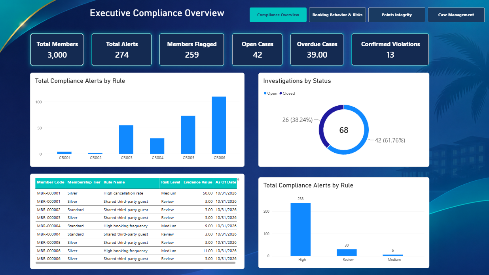
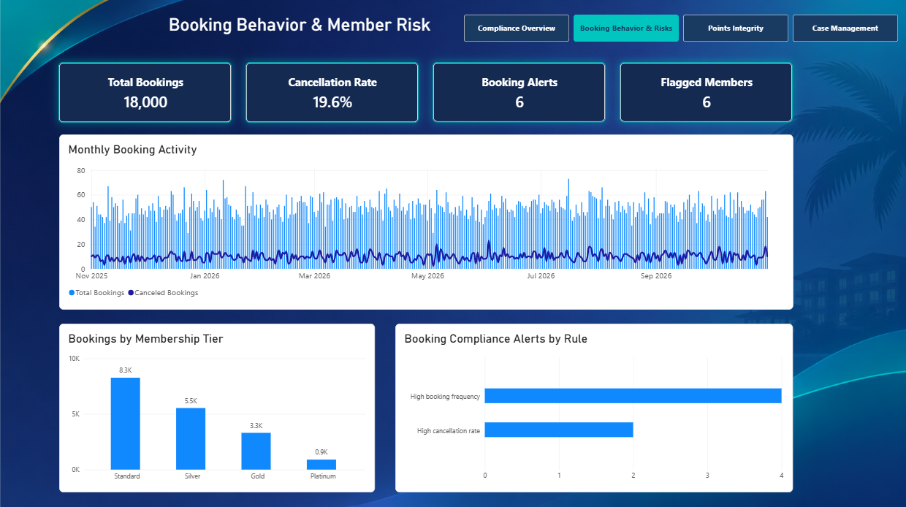
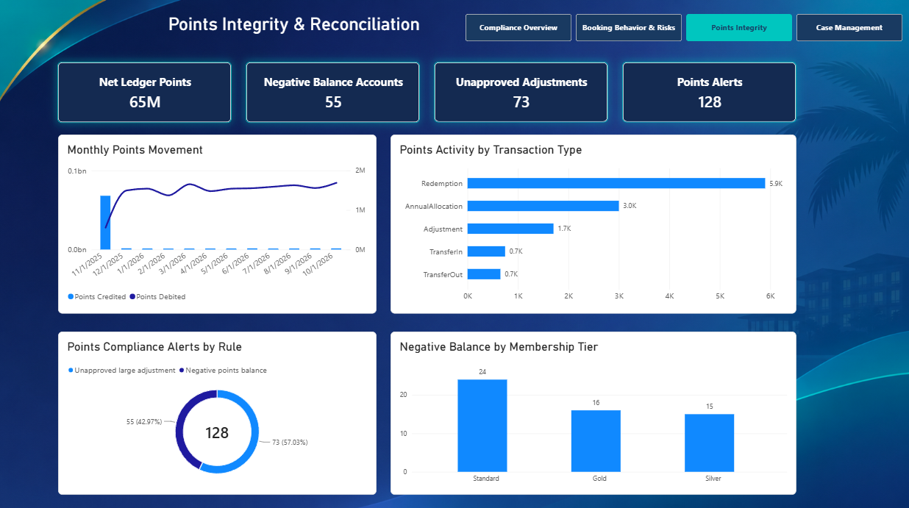
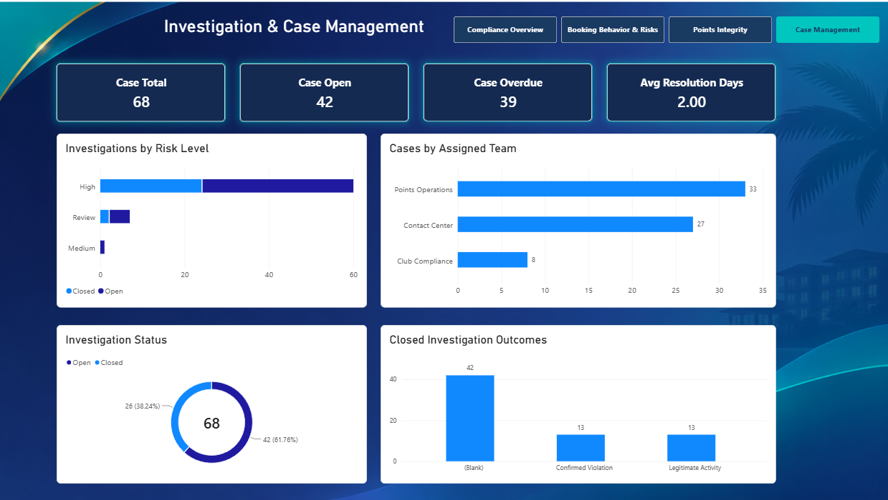

# Vacation Club Compliance & Risk Monitoring

**SQL Server | Python | Power BI | Data Quality | Compliance Analytics**

An end-to-end analytics portfolio project that demonstrates how a vacation club operation can monitor membership and booking activity, detect exceptions, investigate potential policy violations, and report operational risk. The solution combines synthetic operational data, SQL-based compliance rules, and interactive Power BI reporting.

> **Portfolio project:** All records are synthetic. Alerts indicate conditions requiring review—not confirmed misconduct or policy violations. This project is not affiliated with, endorsed by, or based on confidential data from any vacation club company.

## Project objectives

- Validate and organize member, resort, reservation, points-ledger, and contact-center data.
- Apply documented business rules to identify potential compliance exceptions.
- Analyze booking behavior and points integrity.
- Track investigation ownership, status, due dates, and dispositions.
- Provide leadership with actionable monitoring and reporting views.

## Tools and technologies

| Tool | Role |
|---|---|
| SQL Server / T-SQL | Relational data model, validation queries, compliance detection rules, reporting views |
| Python | Synthetic data generation and data loading |
| Power BI Desktop | Data modeling, DAX measures, interactive dashboards |
| Power Query | Data import and preparation |
| GitHub | Version control and project documentation |

## Data model

The SQL Server database, `VacationClubCompliance`, includes these core tables:

| Table | Purpose |
|---|---|
| `DimMember` | Membership attributes |
| `DimResort` | Resort reference information |
| `DimComplianceRule` | Compliance rule definitions |
| `FactReservation` | Reservation and cancellation activity |
| `FactPointsLedger` | Member points transactions |
| `FactContactCenter` | Account-service interactions |
| `FactComplianceAlert` | Detected rule exceptions |
| `FactInvestigation` | Investigation cases and outcomes |

The project also uses SQL reporting views to support analysis and investigation workflows.

## Compliance detection rules

Six rules were implemented in SQL. The following counts are from the project's initial detection run and may change if the synthetic data is regenerated or the rules are rerun.

| Rule | Detection condition | Alerts |
|---|---|---:|
| CR001 | High booking frequency: more than 8 bookings within a rolling 30-day period | 4 |
| CR002 | High cancellation frequency: over 40% canceled within 90 days, with at least 5 bookings | 2 |
| CR003 | Negative net points balance | 55 |
| CR004 | Same third-party guest associated with 3 or more member accounts | 30 |
| CR005 | Positive points adjustment exceeding 10,000 without approval | 73 |
| CR006 | Contact-center account override without approval | 110 |
| **Total** | | **274** |

**Interpretation:** These are simulated alerts for triage and investigation, not substantiated violations. Multiple alerts can relate to the same member or activity.

## Power BI report pages

### 1. Executive Compliance Overview

Summarizes compliance alerts, affected members, investigation workload, and high-level risk indicators.


### 2. Booking Behavior & Member Risk

Analyzes reservation patterns, cancellations, booking activity, and booking-related compliance alerts.


### 3. Points Integrity & Reconciliation

Examines points credits, debits, net ledger activity, negative balances, and unapproved adjustments. The synthetic reservation and points datasets are not guaranteed to reconcile transaction-for-transaction; exceptions are therefore treated as analytical signals, not proof of wrongdoing.


### 4. Investigation & Case Management

Tracks investigation status, assigned teams, recorded dispositions, risk-level prioritization, and a case review queue.


## Analytical workflow

1. **Generate and load:** Create synthetic operational records with Python and load them into SQL Server.
2. **Validate:** Check row counts, keys, relationships, duplicates, and relevant field values.
3. **Detect:** Run six SQL-based compliance rules and populate the alert table.
4. **Investigate:** Associate selected alerts with investigation records, owners, due dates, and outcomes.
5. **Report:** Build SQL views and Power BI measures to communicate findings and operational priorities.

## Repository structure

The original project package is organized approximately as follows; adjust filenames to match the files you upload:

```text
Vacation-Club-Compliance-Analytics/
├── 01_data/             # Synthetic CSV datasets
├── 02_python/           # Data generation and loading scripts
├── 03_sql/              # Schema, validation, detection, and reporting SQL
├── 04_powerbi/          # Power BI model notes and report assets
├── 05_documentation/    # Build guide, rule catalog, and SOPs
├── 06_images/           # Screenshots 
```

## How to reproduce

1. Install SQL Server, SQL Server Management Studio, Python, and Power BI Desktop.
2. Review the Python scripts and synthetic CSV files in `01_data/` and `02_python/`.
3. Run the schema script in `03_sql/` against a new `VacationClubCompliance` database.
4. Load the synthetic datasets using the provided loading process.
5. Run the data-quality checks, then the compliance detection and investigation/reporting scripts **in their documented order**.
6. Import the relevant SQL tables and views into Power BI Desktop.
7. Recreate the relationships, DAX measures, and report pages described in the project documentation.
8. Validate Power BI totals against SQL query results.

> Before rerunning alert-insertion scripts, check whether they are idempotent or whether existing alerts need to be cleared. Repeated inserts may duplicate results.

## Screenshots

Add screenshots of completed report pages to an `assets/` folder and update the links below:

- Executive Compliance Overview — screenshot pending
- Booking Behavior & Member Risk — screenshot pending
- Points Integrity & Reconciliation — screenshot pending
- Investigation & Case Management — screenshot pending
- Control Effectiveness & Compliance Trends — screenshot pending

## Skills demonstrated

- Data quality assessment and SQL-based validation
- Business-rule design and exception detection
- Source-to-report reconciliation and root-cause investigation
- Compliance case tracking and operational reporting
- Dimensional modeling, DAX, and Power BI dashboard development
- Technical documentation and reproducible analytical workflows

## Limitations and next steps

- The dataset is simulated and does not represent real member behavior or actual regulatory findings.
- Rule thresholds are illustrative business assumptions, not legal or regulatory requirements.
- Investigation outcomes are synthetic; an alert should not be equated with a confirmed violation.
- Complete the control effectiveness page and add final dashboard screenshots.
- Add a data dictionary, model diagram, and explicit run-order instructions if not already included in the repository.

## Project status

**Portfolio build in progress.** Core SQL detection and the first four Power BI report pages have been developed; final report packaging and control monitoring are next.

---

*Created as an independent portfolio demonstration of compliance analytics, data integrity, and business intelligence practices.*
